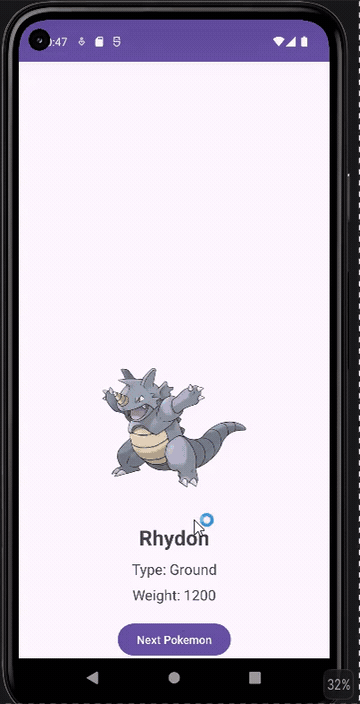

<!-- (This is a comment) INSTRUCTIONS: Go through this page and fill out any **bolded** entries with their correct values.-->

# AND101 Project 5 - Choose Your Own API

Submitted by: **Christian Ramirez**

Time spent: **2** hours spent in total

## Summary

**PokeFinder** is an Android app that displays a random Pokemon using the PokeAPI. The app displays the Pokemon's image, name, type, and weight. Users can press a button to retrieve a new random Pokemon.

If I had to describe this project in three (3) emojis, they would be: **⚡ 🔥 💧**

## Application Features

The following REQUIRED features are completed:

- [x] Make an API call to an API of your choice using AsyncHTTPClient
- [x] Display at least three (3) pieces of data for each API entry retrieved
- [x] A working Button requests a new API entry and updates the data displayed

The following STRETCH features are implemented:

- [ ] Add a query to the API request
    - The query I added is **N/A**
- [ ] Build a UI to allow users to add that query

The following EXTRA features are implemented:

- [x] Display Pokemon artwork using Glide

## API Choice

My chosen API for this project is **PokeAPI**.

## Video Demo

Here's a video / GIF that demos all of the app's implemented features:

GIF created with **ScreenToGif**

## Notes

This project helped me learn how to make API requests in an Android app, read JSON data, and display information from an API. I also learned how to update the app with new data when a button is clicked.

## License

Copyright **2026** **Christian Ramirez**

Licensed under the Apache License, Version 2.0 (the "License");
you may not use this file except in compliance with the License.
You may obtain a copy of the License at

    http://www.apache.org/licenses/LICENSE-2.0

Unless required by applicable law or agreed to in writing, software
distributed under the License is distributed on an "AS IS" BASIS,
WITHOUT WARRANTIES OR CONDITIONS OF ANY KIND, either express or implied.
See the License for the specific language governing permissions and
limitations under the License.